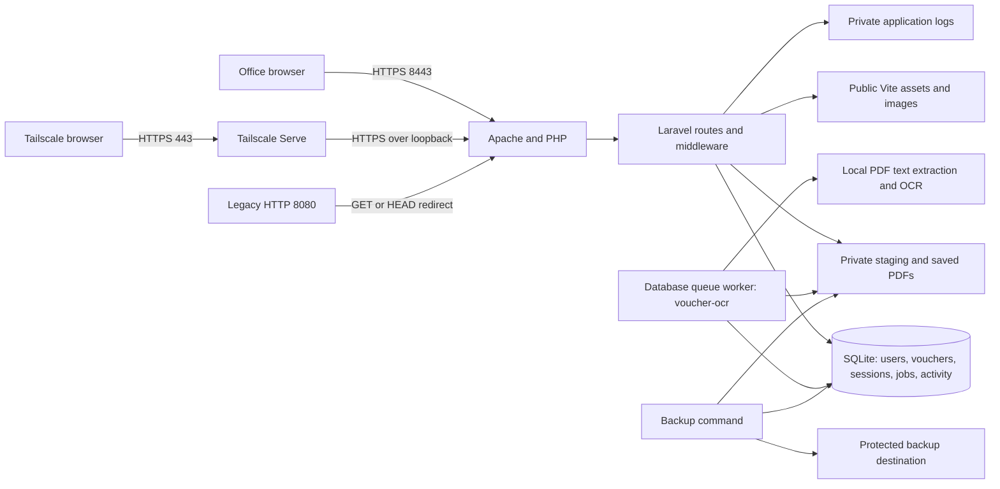
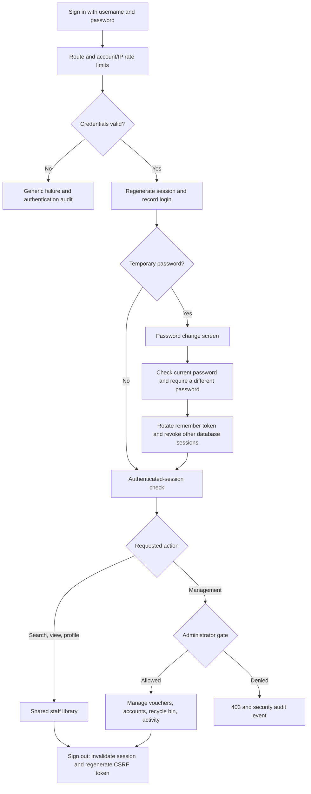

# Architecture

Reviewed: 2026-11-12.

Voucher Tracker is a Laravel 12 application with Blade pages, Vite-built JavaScript/CSS, SQLite records, private PDF files, and a database-backed OCR queue. Office staff search the same library; administrators manage it. The application has no document tenant boundary between staff accounts.

## Request and storage paths

The diagram uses deployment placeholders. It describes the existing private office topology; it is not an instruction to publish the application.

Apache terminates office TLS on port 8443. Tailscale Serve terminates port 443 and connects to the HTTPS backend over loopback. Apache's `mod_remoteip` trusts the loopback proxy for forwarded client-IP handling. Network and hostname allowlists remain deployment controls. The old HTTP listener redirects GET/HEAD requests and refuses state-changing requests.

Only `public/` and the reviewed static serving configuration belong in the web document root. The local filesystem disk uses `storage/app/private`; saved records reference `vouchers/...` paths, and uploads use `staging/...` paths. The application serves those files through authenticated routes. The public disk is separate and does not hold voucher PDFs.

## Authentication and permissions

`routes/web.php` defines the route groups. The `password.changed` middleware restricts temporary-password accounts, and `auth.session` checks authenticated-session password hashes. Gates in `AppServiceProvider` use the account's administrator flag. CSRF middleware protects state-changing browser requests.

Database sessions allow direct revocation of another session row after password or role changes. The current password-change session continues with a regenerated ID. Legacy file sessions rely on the authenticated-session password hash check; a session that never recorded the old hash needs separate operational consideration. Password and session writes on different database connections do not share one atomic transaction.

## Upload, review, and amount reading

The upload controller validates request metadata, PDF content/type, size, and chunk accounting, then stores generated staging paths on the private disk. The current session tracks the upload batch and file identifiers. A staged preview checks that session batch before serving its PDF; an arbitrary path parameter cannot choose another file.

The browser sends upload chunks, requests amount status, and presents editable review fields. `ReadVoucherAmount` and `ReadSavedVoucherAmount` run through the `database` connection on the `voucher-ocr` queue. `PdfAmountReader` tries Poppler text extraction, then Tesseract OCR with Poppler rendering or the Windows rendering fallback. It reads the first page, applies process timeouts, and leaves uncertain amounts for manual entry. The application uses no LLM and no remote OCR endpoint.

Finalization reconciles the files in review, validates the edited fields, and writes saved records/files. File locks coordinate backup, replacement, rename, deletion, and restoration. Session blocking protects batch state from concurrent requests. SQLite transactions protect database changes; file operations require recovery logic because a filesystem and SQLite do not share a transaction.

Soft deletion moves a voucher into the recycle bin while retaining its PDF. Administrators can restore it or purge its record and file. Database uniqueness rules protect voucher number pairs and stored filenames. The browser's confirmation dialogs help users avoid mistakes; server authorization and validation remain the security controls.

## Browser and audit controls

`AddSecurityHeaders` adds private/no-store cache control and same-origin browser policies. Production scripts come from local Vite assets; external JavaScript listeners implement confirmations without inline event handlers. Same-origin PDF frames remain enabled. The local Vite hot-server exception applies only in the local environment. HSTS applies on standard HTTPS port 443; the office port 8443 exception preserves the existing HTTP shortcut behavior.

The application records authentication/account/record events and PDF reads/downloads through its activity recorder. Security auditing records authorization denials and application failures without logging request bodies or PDF content. Successful GET deliveries, including range requests, are logged; HEAD probes are excluded. These are delivery events rather than unique human views. Apache and task logs provide separate transport/process evidence. Keep these records private and apply an office retention policy.

## Recovery and boundaries

`vouchers:backup` takes the voucher file lock, creates a SQLite snapshot, checks integrity, copies saved PDFs including recycled records, and records SHA-256 checksums. It includes the environment file when available and publishes a complete backup directory only after verification. Incomplete directories are not restore sources. The command does not back up the entire operating system, certificate store, native tools, unsaved upload state, or every external configuration file.

The 2026-11-12 review observed PHP 8.5.11 for the CLI and older XAMPP components for Apache and the worker. Runtime replacement, certificate/trust changes, network policy changes, and live recovery need an administrator's maintenance decision. See [setup and deployment](SETUP_AND_DEPLOYMENT.md) for the operating procedures and [the security policy](../SECURITY.md) for reporting and incident handling.
