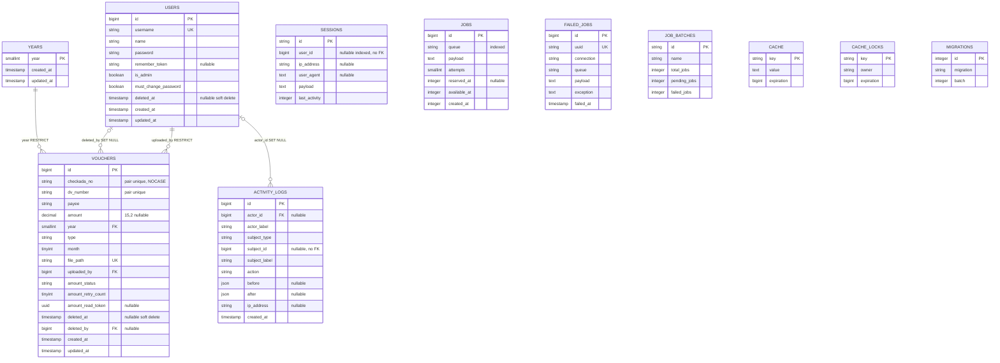

# Developer guide

Source review: 2026-11-12; runtime and development instructions updated 2026-11-16. Start here when taking over development. Use [architecture](ARCHITECTURE.md) for trust boundaries, [setup and recovery](SETUP_AND_DEPLOYMENT.md) for operating procedures, and [office configuration](OFFICE_CONFIGURATION.md) for machine assumptions. The [security audit](SECURITY_AUDIT.md) records release evidence and remaining decisions.

## Stack and source map

The installed framework is Laravel 12.72.0 with PHPUnit 11.5.57. The application uses Blade, Vite, Tailwind CSS, SQLite, private local PDF storage, database sessions/cache, and a database OCR queue. The 2026-11-16 cleanup verified PHP 8.2.12; the earlier 2026-11-12 review observed PHP 8.5.11 on the CLI. Composer declares PHP `^8.2` and models 8.2.12 through `config.platform.php`. Check the web and worker binaries before selecting a runtime. See [dependency inventory](DEPENDENCIES.md) for locked versions and native dependencies.

| Change area | Source entry points |
| --- | --- |
| Routes, middleware, health endpoint | `routes/web.php`, `bootstrap/app.php`; `php artisan route:list --except-vendor --no-interaction` |
| Sign-in, profile, accounts, permissions | `AuthController`, `ProfileController`, `AccountController` in `app/Http/Controllers/`; administrator gates in `app/Providers/AppServiceProvider.php`; `app/Models/User.php` |
| Library, upload/review/save, PDF delivery, rename/move, manual amounts | `app/Http/Controllers/VoucherController.php`, `app/Models/Voucher.php`, `resources/views/vouchers/` |
| Years and recycle bin | `YearController`, `RecycleBinController`, `app/Models/VoucherYear.php`, `app/VoucherRecycleBin.php` |
| Filename parsing | `app/VoucherFilename.php`; validation and storage-name construction in `VoucherController` |
| Upload progress and browser actions | `resources/js/app.js`, `resources/js/voucher-amounts.js`, `resources/js/saved-voucher-amounts.js`; shared layout in `resources/views/layouts/` |
| Amount extraction | `app/PdfAmountReader.php`, `app/VoucherAmountExtractor.php`, `app/render-voucher-page.ps1`, `app/Jobs/ReadVoucherAmount.php`, `app/Jobs/ReadSavedVoucherAmount.php` |
| Activity and security events | `app/ActivityRecorder.php`, `app/RecordAuthenticationActivity.php`, `app/Observers/`, `app/Http/Middleware/AuditSecurityEvents.php`, `ActivityLogController` |
| Headers, file coordination, backups | `app/Http/Middleware/AddSecurityHeaders.php`, `app/Http/Middleware/LockVoucherFiles.php`, `app/Console/Commands/BackupVouchers.php` |
| Schema, bootstrap, tests and CI | `database/migrations/`, `database/seeders/DatabaseSeeder.php`, `tests/`, `.github/workflows/` |

Controllers contain most application workflows; preserve their existing validation and recovery paths when changing them. Check adjacent files and project instructions before editing. The repository has no application API, SSO integration, or full-folder merge/synchronization feature. JSON browser endpoints still use the authenticated web session and CSRF protection.

## Rules to preserve

Staff and administrators share one library. Staff can search, browse and open saved PDFs. Administrators manage uploads, amounts, downloads, folders, moves, renames, recycle-bin actions, accounts and activity history. `uploaded_by` records provenance; it does not restrict PDF visibility to the uploader. Temporary-password accounts must change their password before using the library.

A duplicate requires **both the Check / ADA number and DV number to match**, across all years, types and months. Check / ADA comparison ignores case; the DV remains a digit string, including leading zeroes. Either number alone may repeat with a different partner. Recycled records still reserve the pair. Server checks and the final SQLite unique index enforce the rule; older migrations describe superseded rules, so read the full migration sequence.

Upload filenames suggest metadata using `CHECK_OR_ADA_DV_PAYEE.pdf`, for example `ADA-123_000123_SAMPLE PAYEE.pdf`. The first field accepts 1–40 ASCII letters, digits or hyphens; DV accepts 6–12 digits. The parser accepts a case-insensitive `.pdf` suffix. An unparseable PDF can still enter review with blank metadata for the administrator to complete. Review requires a payee of at most 255 characters. Amounts may remain blank; entered amounts must be positive, at most `9999999999999.99`, and have at most two decimal places.

Saved paths follow `vouchers/{year}/{ADA|CHECK}/{two-digit-month}/{CHECK_OR_ADA}_{DV}_{SANITIZED_PAYEE}.pdf` under `storage/app/private/`. Saving uppercases the Check / ADA field and filename payee; the stored payee text retains its entered value. The server strips unsupported characters from the filename payee and uses `PAYEE` if that part becomes empty. Client filenames never select a server storage path. Renaming accepts a PDF basename up to 150 characters, rejects Windows reserved/unsafe names, and updates voucher metadata when the new name matches the parser format. An arbitrary valid PDF basename changes the name without changing metadata.

Choosing **Replace** for an occupied year/type/month folder replaces only active records whose two voucher numbers match incoming files in that same folder. It leaves other saved PDFs alone and can add new pairs. It does not delete the folder, replace a pair elsewhere, or overwrite a recycled pair. The server snapshots replacement targets when the user chooses Replace and rejects a target that changed before save. A partial save keeps rejected files in review and removes successfully saved files from that batch.

| Limit | Enforced value and source |
| --- | --- |
| One PDF | 524,288,000 bytes = **500 MiB**; Laravel file rule `max:512000` in `VoucherController::stageUploadedFile`; browser `maxFileBytes` in `resources/js/app.js` |
| Whole upload batch/folder | **5,000,000,000 bytes = 5 decimal GB**, about 4.657 GiB; `MAX_FOLDER_BYTES` and browser `maxFolderBytes` |
| One multipart part | 943,718,400 bytes = 900 MiB; `MAX_CHUNK_BYTES` and browser `maxChunkBytes` |
| Files per part | Browser sends up to 5 whole PDFs; server accepts up to 20 (`maxChunkFiles`, `MAX_FILES_PER_CHUNK`) |
| Declared batch count | 1–20,000 PDFs for the chunk workflow; legacy single-request upload accepts up to 30 |

Some UI messages say “500 MB”; the enforced file limit uses binary MiB. Multipart framing needs extra space beyond PDF bytes. Count and byte accounting include received files that fail PDF validation, so rejected files cannot bypass the batch limit. PHP, Apache, free space and temporary storage can impose tighter limits; see the [configuration catalog](OFFICE_CONFIGURATION.md).

## Upload and OCR lifecycle

The browser starts a session-owned batch, groups whole files into multipart parts, sends them in sequence, and reconciles counts before review. This is chunking a selection, not splitting one PDF into byte ranges. A batch UUID and per-part UUID make a repeated accepted part idempotent within that session. The browser makes one automatic retry after a transport failure and offers **Retry upload** for recovery. A completion-count mismatch retains staged files and returns accepted part IDs. An expired or replaced session requires a new batch.

Retry state and selected `File` objects live in the open page's memory. The application does not persist a cross-browser or post-reload upload-resume manifest. The server stores staged files privately as `staging/{UUID}.pdf` and tracks their membership in the session's `voucher_upload` value. Preview and removal require that membership. Starting another upload clears the old staged batch; canceling clears its files and cache entries. Keep the session available through review. Session expiry and a one-day OCR cache lifetime do not provide a durable draft guarantee.

Both OCR jobs explicitly use connection `database`, queue `voucher-ocr`, one attempt, and a 60-second job timeout. `PdfAmountReader` first tries first-page Poppler text extraction, then first-page local OCR using Tesseract and Poppler rendering or the Windows fallback. It uses no remote OCR service or LLM. Native command timeouts are 5 seconds for text extraction and 20 seconds each for rendering and OCR.

`amount_status` is `pending`, `ready` or `manual`. A save can finish while the staged amount read is pending: finalization creates a saved-record read with a generation token so background reading can continue against the saved PDF. Saved jobs update only the matching token, pending state and still-null amount. A manual amount or a newer generation wins over late OCR results and failures. An unreadable PDF, unavailable tool, invalid result or failed saved job leaves manual entry available. There is no user-facing OCR retry button or retry route; `amount_retry_count` remains in the schema for compatibility. Investigate worker failures through the operating procedure instead of adding a UI retry around them.

SQLite transactions cover records, while a shared filesystem lock coordinates saved-file changes with backup. Filesystem changes need compensating recovery; they cannot share a SQLite transaction. Preserve the quarantine/restore logic for replacement, rename and move. Soft deletion retains the saved file until an administrator purges it.

## Database relationships

This diagram follows the final committed migrations, including later alterations. It shows domain columns and supporting tables rather than every queue payload field. `FK` marks an actual database foreign key.



The composite unique index is `(checkada_no COLLATE NOCASE, dv_number)` and includes soft-deleted vouchers. `file_path` is also unique. Users and vouchers use `deleted_at`; years do not. Soft deletion does not execute foreign-key deletion actions. The uploader/deleter model relationships include deleted users. `sessions.user_id` is only an indexed association, and activity subjects are labels/IDs without a foreign key; do not infer cascade cleanup from those columns. Queue, cache, batch and migration tables have no domain foreign keys.

## Isolated development

Create a separate checkout from the approved repository, with no copied production `.env`, database, PDFs, backups, certificates or logs. Open a fresh terminal in that checkout. Confirm its path before running these commands; do not use the live application's directory. Check that inherited `DB_*`, `LARAVEL_STORAGE_PATH` and `APP_CONFIG_CACHE` settings do not point outside it.

```powershell
Get-Location
php --version
composer --version
node --version
npm --version
composer run setup
composer show --direct
php artisan db:seed --no-interaction
composer run dev
```

Setup refuses an existing environment, cached configuration, populated SQLite database, or inherited key/environment/database/storage/cache settings before installing dependencies or generating a key. See [setup and recovery](SETUP_AND_DEPLOYMENT.md) for the exact checks and how to handle an interrupted setup. The example environment uses local SQLite under that checkout, private local storage and database sessions/cache/queue. The seed command bootstraps only an account-empty installation, including checking soft-deleted accounts. It prints a generated one-time temporary administrator password; keep the output private and change the password at first sign-in. Re-seeding does not reset an existing account. For another local staff account, use `php artisan users:create-staff example.staff --name="Example Staff" --no-interaction` and protect its printed temporary password too.

Generate an application key only for a new installation. Never use `key:generate`, `composer setup`, `migrate:fresh`, `db:wipe`, or copying `.env.example` as an update or production recovery procedure. Follow [setup and recovery](SETUP_AND_DEPLOYMENT.md) for existing installations.

`composer run dev` starts the Laravel server, the database `voucher-ocr` worker, and Vite together, with both web servers bound to `127.0.0.1`. Ctrl+C stops them. Avoid the office startup wrappers for development because they can start the machine's scheduled task. Missing OCR tools leave manual entry available.

## Change and test selection

Before changing behavior, inspect the caller, route, Blade page, JavaScript and relevant tests together. Check installed package versions with `composer show <vendor/package>` and `package.json`; use the committed lockfiles for installation. Read applicable project skills/rules and use version-matched documentation. Use migrations for schema changes and preserve the final duplicate index. Do not change dependencies as part of an unrelated feature.

| Change | Start with these existing checks |
| --- | --- |
| Pair identity, folder replacement, rename/move | `VoucherDuplicateRulesTest`, `VoucherReplacementTest`, `VoucherReviewSafetyTest`, `VoucherLibraryUsabilityTest` |
| Upload validation, accounting, staged ownership | `UploadSecurityTest`, `UploadAccountingTest`, `VoucherUploadTest`, `StagedPdfPreviewTest` |
| OCR and manual amounts | `PdfAmountReaderTest`, `VoucherAmountExtractorTest`, `VoucherAmountQueueTest`, `SavedVoucherAmountTest`, `SavedAmountWorkflowTest`, `VoucherAmountRetryTest` |
| Authentication, roles, account bootstrap | `AuthenticationTest`, `StaffAccessTest`, `AccountManagementTest`, `PasswordSessionSecurityTest`, `DatabaseSeederSecurityTest` |
| File locking, recycle bin, backup | `VoucherFileConcurrencyTest`, `VoucherReplacementLockTest`, `VoucherRecycleBinTest`, `BackupVouchersTest` |
| Headers, auditing, activity | `SecurityHeadersTest`, `SecurityAuditTest`, `ActivityHistoryTest` |
| Browser forms and amount polling | `tests/voucher-forms.test.mjs`, `tests/voucher-amounts.test.mjs`; then the relevant browser flow |

For example, from the disposable checkout:

```powershell
php artisan test --compact tests/Feature/VoucherDuplicateRulesTest.php --no-interaction
node --test tests/voucher-forms.test.mjs tests/voucher-amounts.test.mjs
php vendor/bin/pint --dirty --format agent
npm run build
```

Run the narrow tests for the change, then the broader release checks in [setup](SETUP_AND_DEPLOYMENT.md). PHPUnit uses in-memory SQLite, array sessions/cache and storage fakes in applicable tests; do not replace these with production settings. An optional native OCR integration uses `VOUCHER_OCR_SAMPLE` with `tests/Fixtures/amount-5250-scan.pdf`. Browser and concurrency harnesses prepare disposable databases/storage; follow their fixture checks and the CI workflow. `BASE_URL` can target an external preview, so review it before browser execution. Keep the multi-gigabyte `tests/large-folder-upload.mjs` check separate from routine tests.

PHPUnit forces a separate configuration-cache path at `storage/framework/testing/phpunit-config.php`; leave that reserved path uncached. The base test case rejects cached or non-testing configuration, a non-memory database, another default connection, or a database URL before database-refresh traits run. Tests that need a file database select their disposable path after this guard. The Composer test command preserves the office configuration cache; do not clear the office cache to prepare tests.

For a release, build assets, remove a stale development hot-server marker through the reviewed release process, check migrations, verify backup/recovery, and restart workers so they load the new code/configuration. Coordinate the machine steps through the [office configuration catalog](OFFICE_CONFIGURATION.md); passing source tests does not prove the native runtime or live topology has changed.
